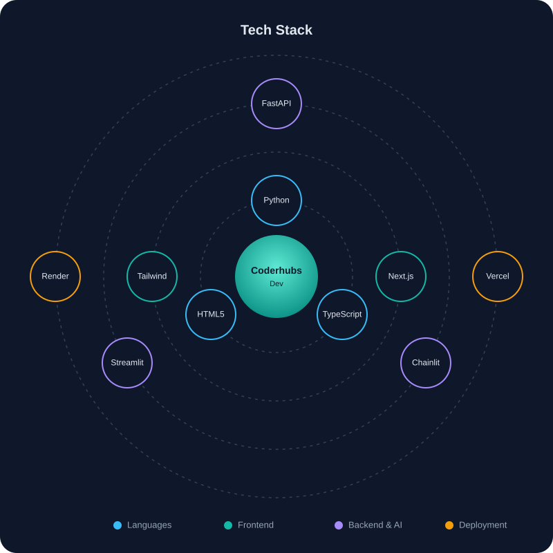

 

 

## 👩‍💻 About

I am a developer from Pakistan working under the alias **Coderhubs**. I build practical AI assistants, modern web applications, and automation tools. I primarily work during **Pakistan Standard Time (PKT) night hours**, which allows smooth collaboration with clients in the US and UK.

## 🎯 Focus Areas

- 🤖 **AI bots and agents:** Conversational interfaces with Python, Chainlit, and FastAPI
- 🌐 **Web applications:** Responsive interfaces with Next.js, Tailwind CSS, and TypeScript
- 📊 **Dashboards:** Data-focused mini apps with Streamlit
- 🧠 **Agentic AI:** Experiments with multi-agent and tool-using systems

## 🚀 Featured Projects

| Project | Stack | Description | Deployment |
|---------|-------|-------------|------------|
| **7-Day Task** | Next.js, Tailwind CSS | Developer tools and UI | [🔗 Vercel](https://7-day-task.vercel.app/) |
| **Resume Builder** | HTML, TypeScript | Real-time resume editor | Vercel |
| **Dashboards** | Python, Streamlit | Interactive data dashboards | Streamlit |
| **AI Chatbots** | Python, Chainlit | Conversational AI assistants | Render |
| **Agentic AI Experiments** | Python | Multi-agent prototypes | Render / Local |

## 🧰 Tech Stack

  

## 📚 Currently Learning

- 🧪 Prompt engineering and generative AI
- 🧩 Claude Skills, Connectors, and Claude Cowork
- 🎓 Preparing for the PCAP certification

## 📈 GitHub Activity

&nbsp;

## 📬 Contact

Open to freelance projects and collaborations, especially with clients in the US and UK.

- 📧 **Email:** simrajabeen16@example.com
- 💼 **LinkedIn:** [Sumra Jabeen](https://www.linkedin.com/in/sumra-jabeen-12037a282)
- 🕐 **Availability:** Night hours (PKT)

 

